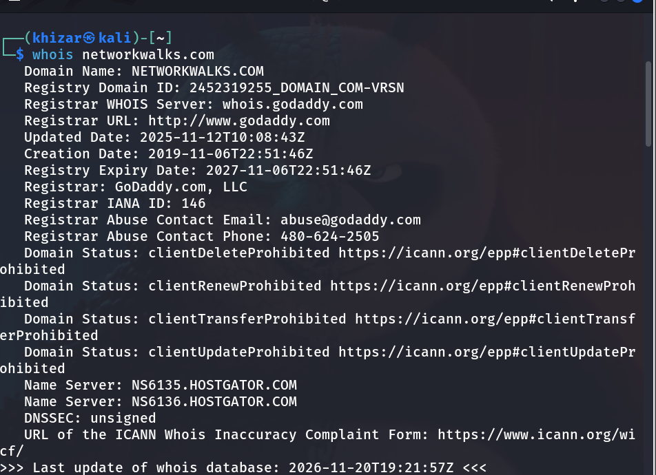
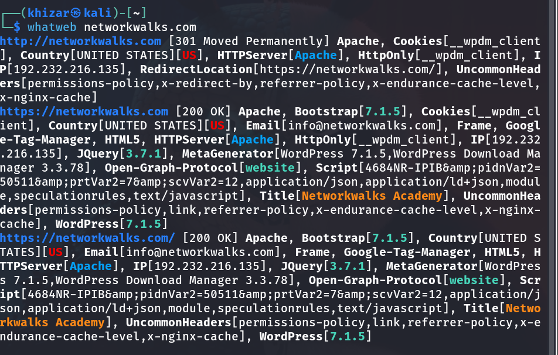
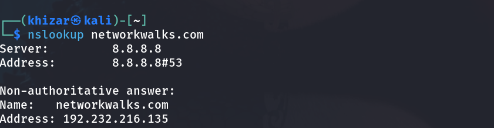
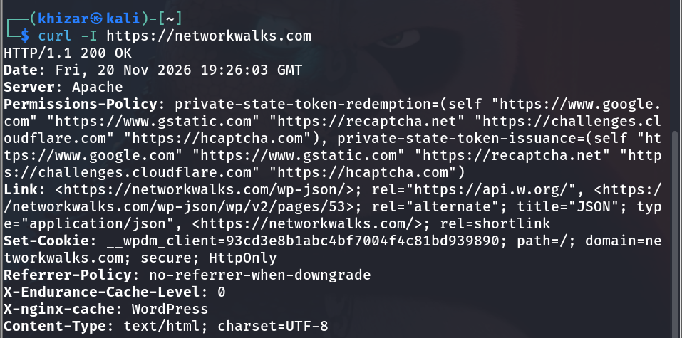
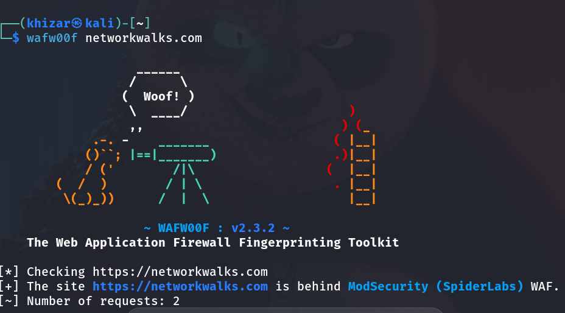
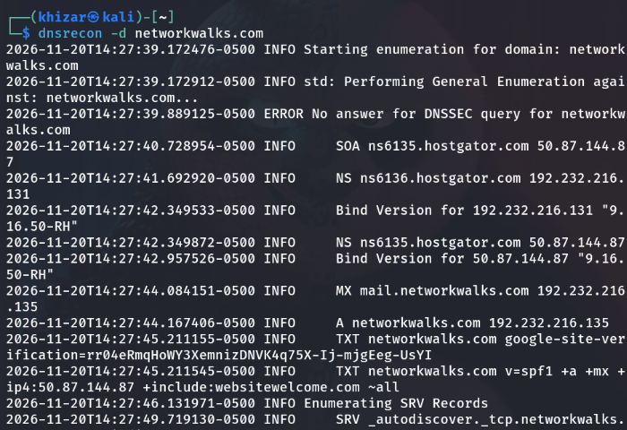
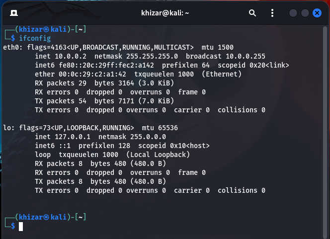
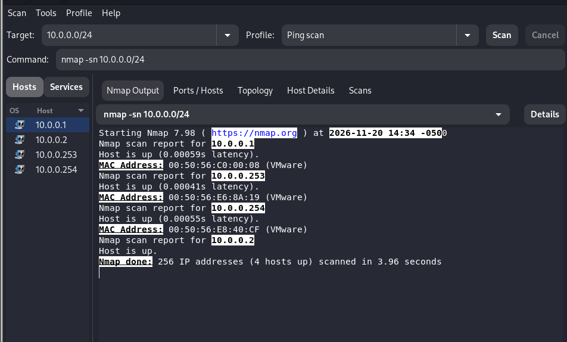
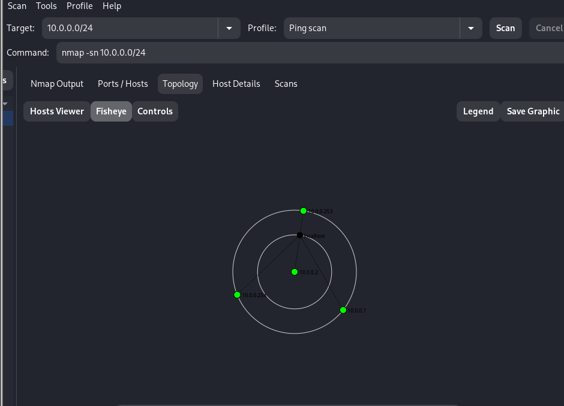

# PENETRATION TESTING REPORT
## FOOTPRINTING & NETWORK SCANNING PHASES

**W2-PM-FINAL | CYBERSECURITY | NETWORKWALKS**

---

## Report Information

| Field | Details |
|---|---|
| Pentester Name | Khizar Ali |
| Program/Batch | [B084L] |
| Date | 21 November 2026 |
| Internship | Cybersecurity & Ethical Hacking Internship |
| Organization | Networkwalks |
| Modules Completed | W2-PM1 and W2-PM5 |
| Client/Target | networkwalks.com and My Own Local LAN |
| Permission | Educational lab and authorized local network scanning |
| Phases Covered | Phase 1: Reconnaissance & Footprinting; Phase 2: Network Scanning |

---

# 1. Liability Disclaimer

All activities documented in this report were performed for educational and cybersecurity training purposes.

Domain reconnaissance was limited to publicly available information, and network scanning was performed on my own local network and devices within my authorized scope.

No exploitation, unauthorized access, or intentional disruption was performed.

These activities were conducted as part of my cybersecurity internship to understand the fundamentals of footprinting, reconnaissance, and network discovery.

---

# 2. Introduction

This report documents the practical activities completed during Week 2 of my Cybersecurity and Ethical Hacking Internship at Networkwalks.

The main objective was to understand how cybersecurity professionals collect information about websites and identify active devices within a local network.

Two practical modules were completed:

**W2-PM1: Footprinting with Multiple Kali Linux Tools**

In this module, I used six different Kali Linux tools to gather publicly available information about the Networkwalks website.

**W2-PM5: Zenmap Based Network Scanning**

In this module, I installed Zenmap on Windows and performed network discovery on my local LAN to identify active hosts, IP addresses, MAC addresses, and network topology.

This report includes the tools used, activities performed, observations, potential risks, recommendations, and screenshots collected during the practical exercises.

---

# 3. Tools Used

The following tools were used during the Week 2 practical activities.

| Tool | Purpose |
|---|---|
| Kali Linux | Operating system used for footprinting |
| WHOIS | Find domain registration information |
| WhatWeb | Identify website technologies |
| Nslookup | Resolve domain names to IP addresses |
| Curl | Inspect HTTP response headers |
| Wafw00f | Detect Web Application Firewalls |
| DNSRecon | Enumerate DNS records |
| Zenmap | Graphical network scanning tool |
| Windows CMD | Identify local IP and network configuration |

---

# 4. Activities Performed

## 4.1 Footprinting and Reconnaissance

**Target Domain:** networkwalks.com

In this activity, I used six different Kali Linux tools to collect publicly available information about the target domain.

### Task 1: WHOIS

WHOIS was used to obtain domain registration information.

It helped identify publicly available registration details, domain dates, registrar information, and name servers.

**Command Used:**

`whois networkwalks.com`

**Evidence:**

### Task 1: WHOIS Results Screenshot

### Task 2: WhatWeb

WhatWeb was used to identify the technologies and frameworks used by the target website.

It helps identify web servers, CMS platforms, plugins, and other technologies.

**Command Used:**

`whatweb https://networkwalks.com`
**Evidence:**

### Task 2: WhatWeb Results Screenshot

### Task 3: Nslookup

Nslookup was used to resolve the domain name into its corresponding IP address.

It helped identify the IP address associated with the target domain.

**Command Used:**

`nslookup networkwalks.com`

**Evidence:**

### Task 3: Nslookup Results Screenshot

### Task 4: Curl

Curl was used with the `-I` option to inspect the HTTP response headers of the website.

It helped understand how the web server responds to HTTP requests.

**Command Used:**

`curl -I https://networkwalks.com`

**Evidence:**

### Task 4: Curl HTTP Headers Screenshot

### Task 5: Wafw00f

Wafw00f was used to identify whether a Web Application Firewall (WAF) protects the target website.

A WAF helps monitor and filter potentially malicious HTTP requests.

**Command Used:**

`wafw00f https://networkwalks.com`

**Evidence:**

### Task 5: Wafw00f Results Screenshot

### Task 6: DNSRecon

DNSRecon was used to enumerate publicly available DNS records.

It helped identify DNS-related information, including name servers, mail servers, and other DNS records.

**Command Used:**

`dnsrecon -d networkwalks.com`

**Evidence:**

### Task 6: DNSRecon Results Screenshot

---

## 4.2 Network Scanning with Zenmap

In this activity, I used Zenmap on my Windows PC to perform network discovery on my local network.

The main objective was to identify active hosts, their IP addresses, MAC addresses, and visualize the network topology.

### Task 1: Download and Install Zenmap

I downloaded and installed Zenmap on my Windows PC using the official Nmap website.

Zenmap provides a graphical interface for Nmap and makes network scanning easier to understand.

### Task 2: Identify Local IP Address and LAN Subnet

I used Windows Command Prompt to identify my local IP address and subnet configuration.

**Command Used:**

`ipconfig`

**Evidence:**

### Task 2: Local IP and LAN Subnet Screenshot

### Task 3: Find Live Hosts

I entered my LAN subnet into Zenmap and performed a Ping Scan to discover active devices on the network.

This helped identify which devices were responding during the scan.

**Scan Type:** Ping Scan

**Target:** [10.0.o.0/24]

### Task 4: Count Live Hosts

After completing the network scan, I reviewed the results to identify the number of active hosts.

**Total Live Hosts Found: [4]**

**Evidence:**

### Task 4: IP Addresses of Live Hosts

### Task 5: Identify IP Addresses

The scan results provided the IP addresses of the active devices discovered on my local network.

| No. | Live Host IP Address |
|---|---|
| 1 | [10.0.0.1] |
| 2 | [10.0.0.253] |
| 3 | [10.0.0.254] |
| 4 | [10.0.0.2] |

### Task 6: Identify MAC Addresses

I reviewed the Zenmap scan results to identify the MAC addresses of the discovered hosts.

MAC addresses help identify network interfaces on local networks.

### Task 7: Network Topology

After completing the scan, I opened the Topology section in Zenmap.

The topology view provided a graphical representation of the discovered network hosts.

I enabled the topology legend and exported the network topology into PDF format.

**Evidence:**

### Task 6: Network Topology Screenshot

---

# 5. Risk Analysis / Impact

Based on the information collected during the footprinting and network scanning activities, the following potential security observations were identified.

| No. | Finding | Potential Impact | Risk Level |
|---|---|---|---|
| 1 | Website technology information is publicly visible | May help identify technologies requiring security updates | Low |
| 2 | Domain IP address is identifiable | Provides information about hosting infrastructure | Low |
| 3 | HTTP response headers are accessible | May expose technical information about the web server | Low |
| 4 | WAF technology can be identified | Reveals information about website security architecture | Low |
| 5 | DNS records are publicly available | Helps build an understanding of domain infrastructure | Low |
| 6 | Multiple live hosts discovered on LAN | Unknown devices may require investigation | Medium |

**Note:** These are potential security observations, not confirmed vulnerabilities. The practical activities focused on information gathering and network discovery. No exploitation or vulnerability validation was performed.

---

# 6. Recommendations

Based on the practical activities, the following security recommendations are suggested:

1. Regularly review publicly exposed website technologies.
2. Keep website CMS platforms and plugins updated.
3. Review HTTP response headers to minimize unnecessary information exposure.
4. Regularly monitor and review DNS records.
5. Properly configure and maintain Web Application Firewalls.
6. Perform regular network discovery to identify active devices.
7. Investigate unknown devices connected to the local network.
8. Maintain updated network documentation and topology diagrams.
9. Perform cybersecurity assessments only with proper authorization.

---

# 7. Conclusion

During Week 2 of my Cybersecurity and Ethical Hacking Internship at Networkwalks, I completed practical activities related to footprinting, reconnaissance, and network scanning.

In the first module, I used six Kali Linux tools: WHOIS, WhatWeb, Nslookup, Curl, Wafw00f, and DNSRecon. These tools helped me understand how publicly available information about a website can be collected and analyzed.

In the second module, I installed and used Zenmap on Windows to perform network discovery. I identified my local IP address, LAN subnet, active hosts, IP addresses, and MAC addresses. I also generated a graphical network topology and saved it in PDF format.

These activities helped me understand the importance of information gathering and network discovery in cybersecurity.

I also learned how to document technical activities, analyze potential security observations, and present findings in a structured penetration testing report.

Overall, Week 2 improved my practical understanding of footprinting, reconnaissance, and network scanning.

---

# 8. Evidence Collection

The following screenshots and files were collected during the practical activities.

### Footprinting Evidence

1. WHOIS Results
2. WhatWeb Results
3. Nslookup Results
4. Curl HTTP Headers
5. Wafw00f Results
6. DNSRecon Results

### Zenmap Evidence

7. Zenmap Installation
8. Local IP and Subnet Information
9. Live Hosts Discovery
10. IP Addresses of Live Hosts
11. MAC Addresses of Live Hosts
12. Network Topology

### Final Output

`Network-Topology.pdf`

All screenshots and supporting files are available in the `screenshots` folder of this repository.

---

**End of Report**

**Prepared by:** Khizar Ali  
**Program:** Cybersecurity & Ethical Hacking Internship  
**Organization:** Networkwalks
